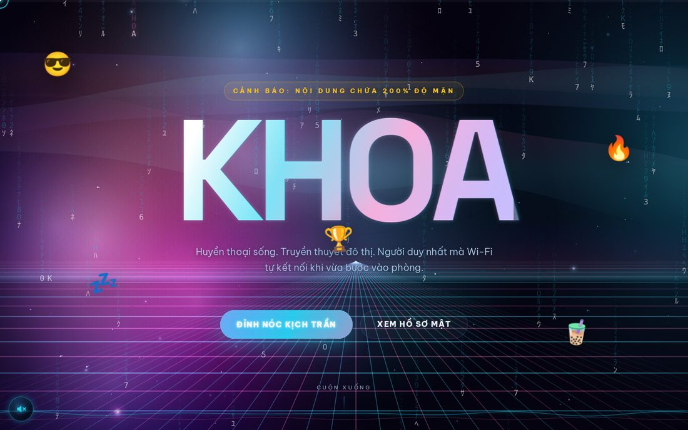
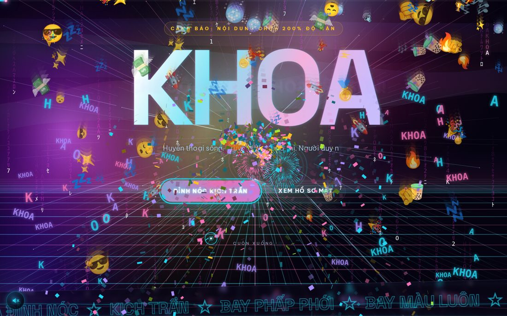

# KHOA — đỉnh nóc kịch trần bay phấp phới

Một trang web đùa về Khoa. Toàn bộ hiệu ứng được viết tay bằng JavaScript thuần, **không dùng một thư viện ngoài nào**, không CDN, không bundler. Mở thẳng `index.html` là chạy.

**🔗 Xem trực tiếp: https://baobao1044.github.io/khoapage/**



## Có gì trong này

8 module hiệu ứng độc lập, mỗi module tự đăng ký vào `window.FX` và tự dọn dẹp được:

| Module | Nhiệm vụ |
|---|---|
| `fx/cosmos.js` | Tinh vân nhiều lớp, trường sao 3D bay xuyên, lưới phối cảnh synthwave, cực quang |
| `fx/matrix.js` | Mưa ký tự Matrix, đổi màu theo từng khu vực, chế độ rave |
| `fx/text.js` | 8 hiệu ứng chữ: scramble, gõ máy, glitch tách màu RGB, sóng, gradient chạy, nổ tung, neon, xáo trộn 3D |
| `fx/tilt.js` | Thẻ nghiêng 3D theo chuột, có chiều sâu từng lớp, viền neon xoay, nút hít chuột |
| `fx/scroll.js` | Hiện dần khi cuộn, parallax, đếm số kiểu Việt (1.284.000), marquee, thanh tiến độ |
| `fx/burst.js` | Confetti, pháo hoa, mưa emoji, rung màn hình, sóng xung kích, chữ bay |
| `fx/cursor.js` | Con trỏ tuỳ biến có đuôi sao chổi, phình to khi rê vào nút |
| `fx/audio.js` | Nhạc synthwave tự sinh bằng Web Audio (Am–F–C–G, 92 BPM) + hiệu ứng âm thanh. Không có tệp nhạc nào |

Các module giao tiếp với nhau qua CSS custom property — ví dụ `--fx-bass` do `fx/audio.js` bơm ra khiến chữ nhún theo tiếng bass, `--fx-rave` bật chế độ quẩy toàn trang.

Toàn bộ hiệu ứng được gắn vào HTML bằng thuộc tính `data-*`, không cần viết JS cho từng phần tử:

```html
<h2 data-fx-text="wave">CÂU HỎI THƯỜNG GẶP</h2>
<article class="stat" data-fx-tilt data-fx-tilt-depth>
  <b data-fx-count="1284000" data-fx-count-suffix=" đ">0</b>
</article>
```

## Trứng phục sinh



- `↑ ↑ ↓ ↓ ← → ← → B A` — bật chế độ **RAVE**
- Gõ `khoa` — mưa chữ KHOA thay cho mưa Matrix, pháo hoa, mưa emoji
- Giữ chuột trên nền — tạo lỗ đen hút các hạt
- `M` — bật/tắt nhạc
- Kéo "máy đo độ đỉnh" lên 100 — máy nổ
- Bấm nút **TÔI LÀ KHOA 🫵** hai lần liên tiếp — mega boom

## Hiệu năng và khả năng tiếp cận

- Mỗi module chỉ chạy **một** vòng `requestAnimationFrame`, tự ngủ khi tab bị ẩn
- DPR giới hạn ở 2, ngân sách hạt tự co theo kích thước màn hình
- Tôn trọng `prefers-reduced-motion`: giảm còn ~15% số hạt, tắt nhấp nháy nhanh (an toàn cho người nhạy cảm ánh sáng)
- Không có `filter: drop-shadow` trên phần tử được vẽ lại mỗi khung hình — hào quang nằm ở lớp tĩnh riêng
- Đo trên môi trường dựng hình bằng phần mềm (không GPU): 21,9 fps, trong khi trần của chính môi trường đó là 26,7 fps — tức 8 module chỉ tốn khoảng 5 fps

## Chạy tại máy

Mở thẳng tệp:

```bash
xdg-open index.html
```

Hoặc qua máy chủ tĩnh:

```bash
python3 -m http.server 8000
# rồi mở http://localhost:8000
```

## Cấu trúc

```
index.html        nội dung + khai báo hiệu ứng bằng data-*
css/style.css     giao diện, bảng màu neon, chế độ giảm chuyển động
js/main.js        điều phối: khởi động, đổi màu theo khu vực, ăn mừng, phím tắt
fx/*.js           8 module hiệu ứng độc lập
CONTRACT.md       giao ước API giữa các module (mỗi module một tệp, không đụng nhau)
```

## Ghi chú

Trang này được dựng bằng 8 luồng xử lý song song, 0 thư viện ngoài, và một lượng đùa cợt vượt ngưỡng khuyến nghị. Mọi thông tin đều là bịa. Trừ đoạn Khoa đỉnh. Đoạn đó có thể cũng bịa.
